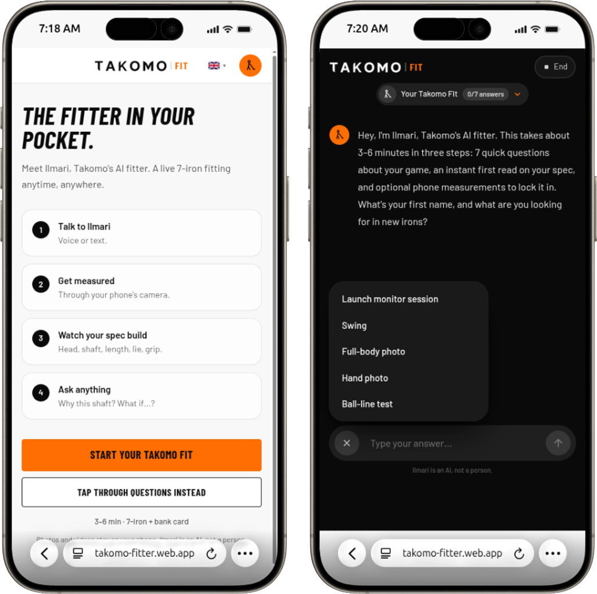
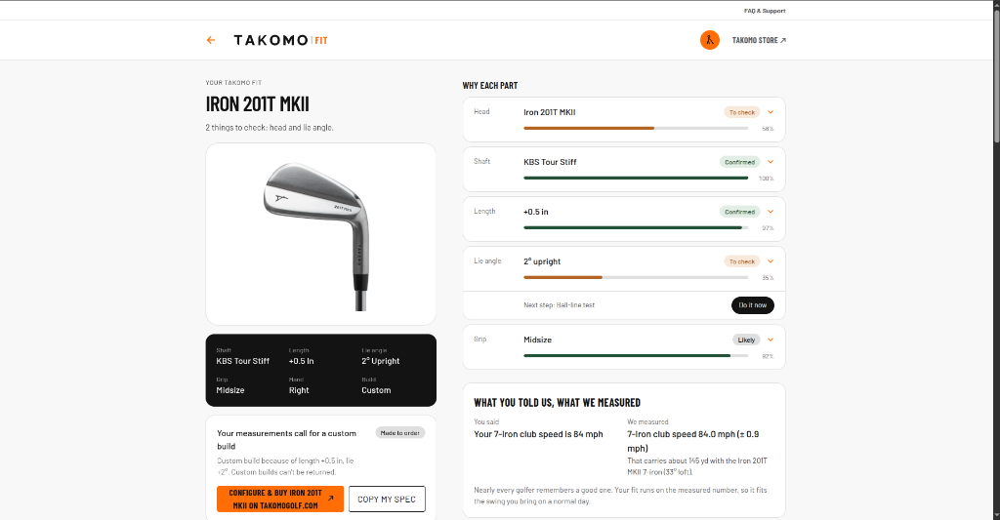
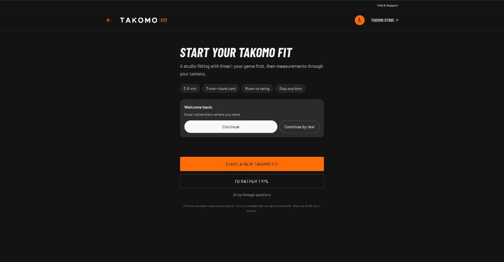
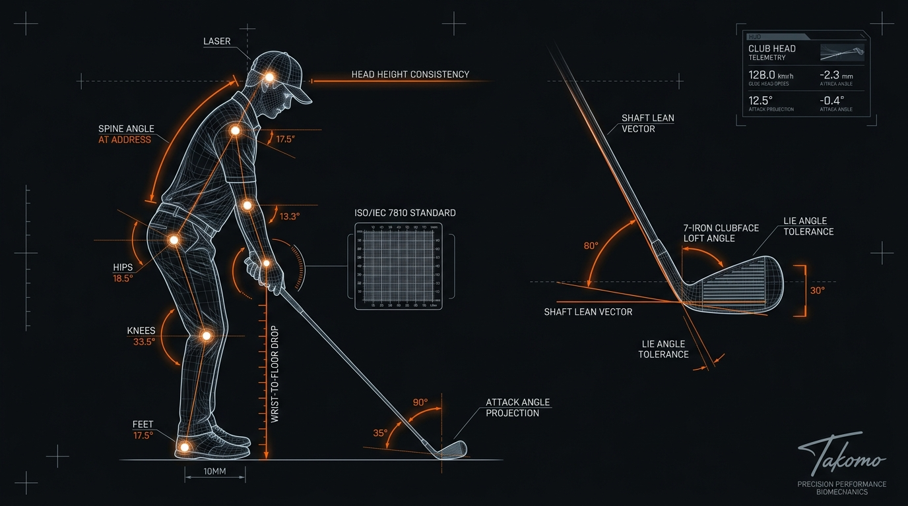
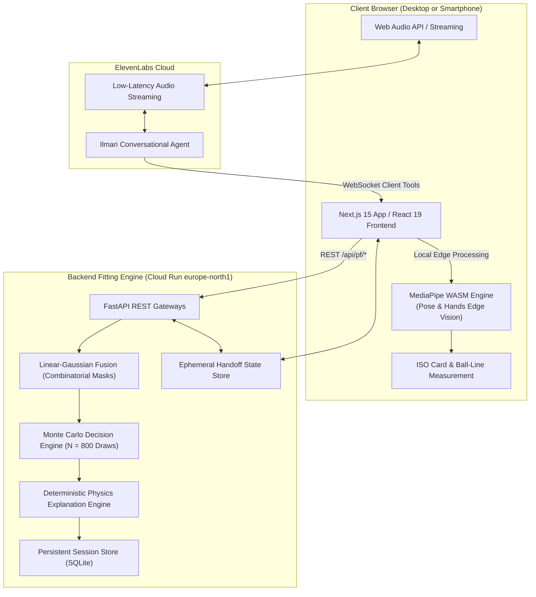

<div align="center">

<a href="https://takomo-fitter.web.app/">
  
</a>

<br/><br/>

**The Fitter in Your Pocket**  
*Multimodal Voice Consultation · Zero-Print Smartphone Vision · Calibrated Bayesian Fitting*

[](https://github.com/0xMuluh/takomo-fit/actions/workflows/ci.yml)
[](https://github.com/0xMuluh/takomo-fit/actions/workflows/deploy.yml)
[](https://takomo-fitter.web.app/)
[](docs/README.md)
[-1f5135?style=flat)](docs/README.md)
[-1f5135?style=flat)](docs/README.md)
[](docs/03_FITTING_ENGINE_MATHEMATICS_AND_CALIBRATION.md)

<p align="center">
  <a href="https://takomo-fitter.web.app/"><strong>Launch Live App »</strong></a> ·
  <a href="#-quickstart">Quickstart</a> ·
  <a href="#-how-it-works">How it works</a> ·
  <a href="#-cloud--production-deployment">Cloud deployment</a> ·
  <a href="#-benchmark--calibration-results">Benchmark</a> ·
  <a href="docs/README.md">Docs</a>
</p>

</div>

---

## ⛳ The challenge: trust at scale

Takomo sells forged, premium golf clubs direct to golfers across 109 countries with no retail middleman, growing from under €3M in 2022 to €70M+ today. Over 25% of all iron orders flow through Takomo's online fitting tool (600,000+ fittings in the past six months).

**The central bottleneck to online club fitting is trust:**
* **Self-reporting noise:** Higher-handicap golfers overestimate 7-iron carry by an average of 14 yards, and 7-iron lofts vary up to 5° across brands (~12 m carry difference on the exact same swing).
* **Static black boxes:** Standard web forms ask for guesses and return a static spec without explanations, conversation, or physical evidence.
* **Return anxiety:** Custom builds cannot be returned under Takomo’s 30-day policy. Hesitant golfers abandon carts between stock and custom configurations.

**Takomo Pocket Fitter** turns a web questionnaire into an hour with a trusted pro fitter on the golfer’s smartphone or computer.

---

<h2 id="-how-it-works">🏌️ Meet Ilmari: the fitter in your pocket</h2>

<div align="center">
  
</div>

**"Ilmari"** is Takomo’s conversational AI club fitter, voiced by **ElevenLabs Conversational AI** and driven by Takomo's Bayesian engine. He talks like the best playing partner you've ever been paired with: candid, relaxed, technical without jargon, and powered by client-side tools in English, Finnish, Swedish, and German.

* **Respectful verification:** Flags suspicious self-reported numbers with a smile: *"A 170-yard 7-iron is long for an 82 mph swing. Let's verify whether that's carry or total, or check your current club's loft."*
* **Ball-flight physics:** Explains specifications in terms of actual ball flight: *"At your 150-yard carry, your dynamic toe-down impact pushes shots 4.2 yards right with standard lie. A 2° upright lie squares the face at impact."*
* **Transparent close calls:** When two heads or shafts differ by under 5% probability, Ilmari highlights the runner-up and outlines the specific trade-offs (e.g. forgiveness vs workability).
* **Stock set protection:** Advises keeping a stock set with its full 30-day return policy whenever custom advantages fall within practical tolerance.

---

## 📱 Visual experience showcase

<div align="center">

| Multimodal voice consultation (`/fit`) | Calibrated fit results & breakdown |
|:---:|:---:|
|  |  |
| *Real-time ElevenLabs voice agent, audio waveforms, live camera triggers, and progressive confidence.* | *Calibrated Bayesian iron recommendation, per-component confidence meters, and trade-off explanations.* |

| Studio entry & session resume | Biomechanics & posture tracking |
|:---:|:---:|
|  |  |
| *Direct-to-consumer digital studio on Takomo Golf shop.* | *On-device MediaPipe landmark extraction, ISO card millimeter scale factor, and swing kinematics.* |

</div>

---

## ⚡ Technical innovations

### 1. Zero-print ISO card reference scale (no printer needed)
Starter kits often rely on printable A4 ArUco target sheets. Fewer than 35% of modern homes have working printers.
* **Our solution:** Uses any standard payment card (**ISO/IEC 7810 ID-1**: $85.60 \text{ mm} \times 53.98 \text{ mm}$, found in every wallet worldwide) as an optical anchor.
* Edge vision segments the card boundaries in the browser, confirms aspect ratio ($\pm 4\%$), and derives scale $s = \frac{85.60\text{ mm}}{w_{\text{px}}}$.

### 2. Zero-video-egress edge biometrics (100% client-side WASM)
* **Privacy & GDPR:** Zero video frames or photos leave the golfer's device.
* **MediaPipe Pose & Hands:** Runs inside browser WebAssembly / WebGL on iOS Safari and Android Chrome. Only scalar measurements (e.g., `height_cm: 182.4`, `hand_length_cm: 19.1`) are transmitted over TLS to the engine.

### 3. Multi-device handoff (`/m/[code]`)
* Desktop shoppers click **"Measure with Phone"**, scan a QR code, and instantly transition to their mobile camera with zero login.
* Live camera coaching cues (*"Step back until feet are visible"*) stream back to the desktop in real time via lightweight polling.

### 4. Dynamic strike & launch monitor ingestion
* **Ball-line lie analysis:** 4-point interactive impact tool measures dynamic face tilt angle ($\theta_{\text{tilt}}$) from ball marker lines, capturing shaft droop during the downswing.
* **Launch monitor ingestion:** Parses CSV exports or photos of screens from TrackMan, FlightScope, Garmin R10, and Bushnell Launch Pro via vision LLM.

---

## 📐 System architecture



---

## 📊 Benchmark & calibration results

Evaluated against Takomo's official Fitting Lab benchmark split (**3,000 unseen dev golfers** with ground truth):

| Performance metric | Today's questionnaire (B1) | Static rules + phone (B2) | **Takomo Pocket Fitter** |
|---|:---:|:---:|:---:|
| **Spec agreement score** | 77.10 / 100 | 83.60 / 100 | **87.91 / 100** *(+10.8 pts)* |
| **Full spec exact match** | 13.7 % | 25.3 % | **39.0 %** *(~3x Baseline)* |
| **Unbuildable specs** | — | — | **0 (100% Feasible)** |
| **Flex agreement** | 64.0 % | 74.2 % | **83.6 %** |
| **TrackMan lie agreement** | — | — | **85.6 %** |

<div align="center">
  
</div>

### Strict uncertainty calibration (ECE < 0.015)
Unlike overconfident deep nets, our linear-Gaussian fusion and HistGradientBoosting classifiers achieve an **Expected Calibration Error under 0.015** across every component. When the engine reports $\ge 95\%$ confidence, empirical accuracy is **98.8% to 99.7%** (awarded the **"Confirmed"** badge in the UI).

| Component | Stated mean confidence $\bar{c}$ | Empirical accuracy $\bar{a}$ | Expected calibration error (ECE) |
|---|:---:|:---:|:---:|
| **Head model** | 88.2% | 87.1% | **0.0140** |
| **Shaft flex** | 83.5% | 83.6% | **0.0064** |
| **Club length** | 89.8% | 89.3% | **0.0085** |
| **Lie angle** | 49.4% | 49.0% | **0.0098** |
| **Grip size** | 86.0% | 87.4% | **0.0145** |
| **Full complete spec** | 28.5% | 28.0% | **0.0094** |

---

## 🚀 Quickstart

### Prerequisites
* Python 3.12+
* Node.js 20+ or 24+
* Docker & Docker Compose (optional)

### 1. Run engine (FastAPI on port 8077)
```bash
cd engine
python -m venv .venv && source .venv/bin/activate
pip install -e .[dev]

# Optional: retrain model (pre-trained artifacts/model.joblib is already included)
# python scripts/train.py

uvicorn pocketfit.api:app_factory --factory --port 8077
```

### 2. Run web frontend (Next.js on port 3000)
```bash
cd web
npm install
npm run build && npm start    # or: npm run dev
```

Open [http://localhost:3000](http://localhost:3000). The frontend automatically proxies `/api/pf/*` requests to `http://localhost:8077`.

### 3. Enable live voice fitter (ElevenLabs)
```bash
export ELEVENLABS_API_KEY="your-elevenlabs-key"
cd engine && python scripts/setup_voice_agent.py
# Outputs: ELEVENLABS_AGENT_ID=agent_...
export ELEVENLABS_AGENT_ID="agent_..."
```
Restart the engine with both environment variables set. The web app will automatically connect to Ilmari with signed session tokens.

---

## 🧪 Automated testing & verification

```bash
# 1. Engine unit & API tests (62 tests in ~15s)
cd engine && PYTHONPATH=src pytest -m "not slow" -q

# 2. Web typecheck, lint & build
cd web && npx tsc --noEmit && npx eslint src && npm run build

# 3. End-to-end voice scenario simulation (no ElevenLabs key required)
cd web && PF_API_URL=http://localhost:8077 npx jiti scripts/fitter-scenario.ts
```

---

<h2 id="-cloud--production-deployment">☁️ Cloud & production deployment</h2>

### 1. Automated CI/CD (GitHub Actions)
The repository includes automated CI/CD workflows under `.github/workflows/`:
* **Pull Request CI (`ci.yml`):** Runs pytest suite, TypeScript validation, ESLint on `src/`, and Next.js standalone build on every PR.
* **Continuous Cloud Run Deployment (`deploy.yml`):** Automatically triggered on push to `main`:
  1. Authenticates to Google Cloud via `GCP_SA_KEY` secret.
  2. Builds and pushes multi-stage container images to Google Artifact Registry (`takomo-repo`).
  3. Deploys `takomo-engine` to Google Cloud Run in `europe-north1` (locked to `--max-instances 1`, concurrency 80, CPU boost).
  4. Deploys `takomo-web` connected to the engine backend.

### 2. Manual Google Cloud Run deployment (`gcloud`)
To deploy manually from your workstation with the Google Cloud SDK:

```bash
# 1. Configure GCP Project & Region
export PROJECT_ID="sharp-bulwark-488307-i0"
export REGION="europe-north1"
export REPO="takomo-repo"
gcloud config set project $PROJECT_ID

# 2. Build and deploy the FastAPI engine
cd engine
gcloud builds submit --tag ${REGION}-docker.pkg.dev/${PROJECT_ID}/${REPO}/takomo-engine:latest .
gcloud run deploy takomo-engine \
  --image ${REGION}-docker.pkg.dev/${PROJECT_ID}/${REPO}/takomo-engine:latest \
  --region ${REGION} \
  --platform managed \
  --allow-unauthenticated \
  --port 8080 \
  --max-instances 1 \
  --concurrency 80 \
  --cpu-boost

# Retrieve the public engine URL
ENGINE_URL=$(gcloud run services describe takomo-engine --region ${REGION} --format 'value(status.url)')

# 3. Build and deploy the Next.js web application
cd ../web
gcloud builds submit \
  --substitutions=_ENGINE_URL=${ENGINE_URL} \
  --tag ${REGION}-docker.pkg.dev/${PROJECT_ID}/${REPO}/takomo-web:latest .
gcloud run deploy takomo-web \
  --image ${REGION}-docker.pkg.dev/${PROJECT_ID}/${REPO}/takomo-web:latest \
  --region ${REGION} \
  --platform managed \
  --allow-unauthenticated \
  --port 3000 \
  --set-env-vars PF_API_URL=${ENGINE_URL}
```

### 3. Single-server Docker Compose
For on-premise or single-VPS deployment with automatic SSL:
```bash
cp .env.example .env
docker compose up -d --build
```
This launches the FastAPI engine, Next.js web application, and Caddy with automatic Let's Encrypt SSL certificates.

---

## 📂 Deliverables & documentation index

All technical documents, benchmark datasets, and pitch deliverables are hosted in [`docs/`](docs/):

* [**Hackathon submission portal entry**](docs/00_HACKATHON_SUBMISSION.md): Official submission portal fields (tagline, about, tech stack, verified URLs).
* [**Executive summary (1-pager)**](docs/01_ONE_PAGE_EXECUTIVE_SUMMARY.md): Required 1-page executive writeup (slide 16 of challenge brief).
* [**Architecture & system specification**](docs/02_ARCHITECTURE_AND_SYSTEM_SPEC.md): Complete engineering architecture and zero-egress protocol.
* [**Fitting engine mathematics & calibration**](docs/03_FITTING_ENGINE_MATHEMATICS_AND_CALIBRATION.md): Linear-Gaussian conjugate math, ECE proofs, and EVOI formulations.
* [**Computer vision & biomechanics pipeline**](docs/04_COMPUTER_VISION_AND_BIOMECHANICS.md): ISO card geometry, MediaPipe edge vision, and ball-line impact analysis.
* [**API reference & integration guide**](docs/05_API_REFERENCE_AND_INTEGRATION.md): OpenAPI endpoint specifications and headless Shopify cart injection.
* [**Production pilot & business case**](docs/06_PRODUCTION_PILOT_AND_BUSINESS_CASE.md): Financial model (+€3.8M–€7.4M/yr net gain) and 4-phase rollout plan.
* [**Finals pitch deck script**](docs/07_FINALS_PITCH_DECK.md): 10-slide championship finals script and presenter notes.
* [**Demo video & voiceover script**](docs/08_DEMO_VOICE_OVER.md): 3-minute video pitch, trust gap analysis, user journey, and honest validation.
* [**Championship pitch deck (PDF)**](docs/presentation/Takomo_Pocket_Fitter_Finals.pdf): 10-slide championship finals presentation deck ([PPTX source](docs/presentation/Takomo_Pocket_Fitter_Finals.pptx)).
* [**Benchmark test predictions (5,000 golfers)**](docs/test_predictions/takomo_test_predictions.csv): Predictions for all 5,000 unlabelled benchmark test golfers.

---

<div align="center">
  <sub>Built with ❤️ for the <strong>Since AI Hackathon 2026</strong> in partnership with <strong>Takomo Golf</strong> (Turku, Finland).</sub>
</div>
