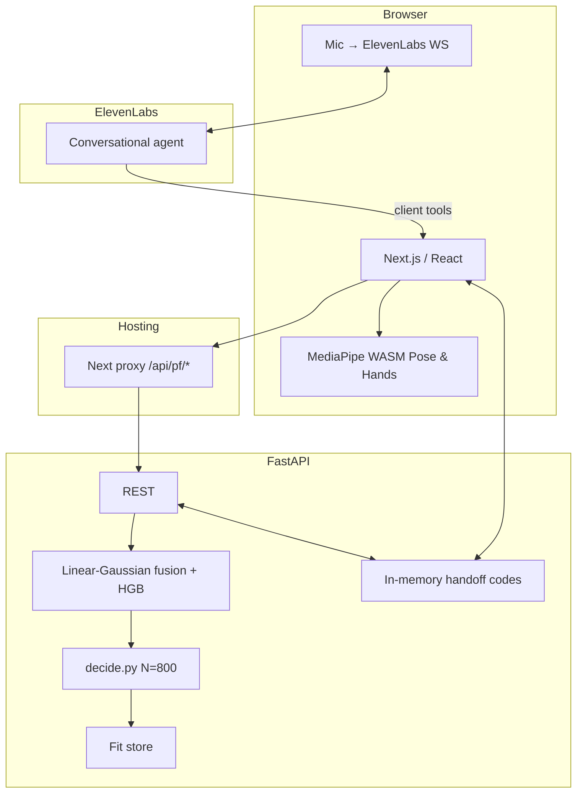
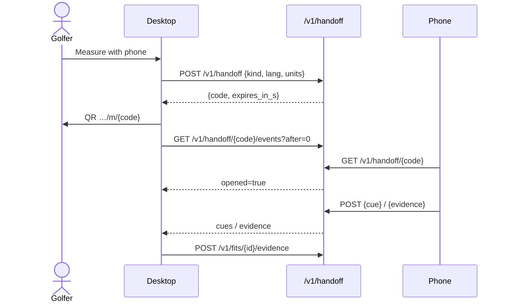

# Architecture

**App:** Takomo Pocket Fitter · Next.js client + FastAPI engine (`pocketfit`)

---

## 1. Topology

Routes of interest: `/fit` (voice), `/fit/guided`, `/m/[code]` (phone handoff). Screenshots not checked into `docs/assets/`.

---

## 2. Client vision

Pose, hands, card edge fit, swing timing, and ball-line geometry run in the browser. The API receives structured evidence (`BodyPhoto`, `HandPhoto`, `SwingVideo`, `ball_line_tilts_deg`, …) — not video blobs for those paths.

Launch-monitor **screen photo / video import** is a separate server path (`/v1/launch-monitor/*`) that reads displayed numbers via a vision API when configured.

---

## 3. Voice

1. Browser calls **`GET /v1/voice/session`** (optional `fit_id`).
2. Engine returns `{ signed_url, fit_id }` from ElevenLabs; API key stays server-side.
3. Rate limit: `PF_VOICE_SESSIONS_PER_HOUR` (default 20 / IP).
4. Agent uses client tools in the browser; server tools under `/v1/agent/*` need `X-Agent-Secret`.

---

## 4. Desktop → phone handoff

Handoffs are in-memory with TTL; expired code → 404. Evidence payload matches `Evidence` in `schemas.py`.

---

## 5. Fitting flow

1. **Questionnaire** → `POST /v1/fits` (`FitRequest`).
2. **Add evidence** → `POST /v1/fits/{id}/evidence`.
3. **Fusion + decide** → `FitResponse` (spec, components, stock_advice, estimates, probabilities, next_tests).
4. **What-if** → `POST /v1/fits/{id}/what-if` (`Overrides`).

Shopify cart injection is **not implemented**; treat as a planned storefront step.

---

## 6. Ops notes (from `api.py`)

| Control | Behavior |
|---|---|
| Voice URL | Ephemeral signed URL; key not in client |
| Voice / handoff / import rate limits | Per-IP hourly counters |
| Request validation | Pydantic bounds in `schemas.py` |
| Fit persistence | Service store (memory or file-backed depending on deploy) |
