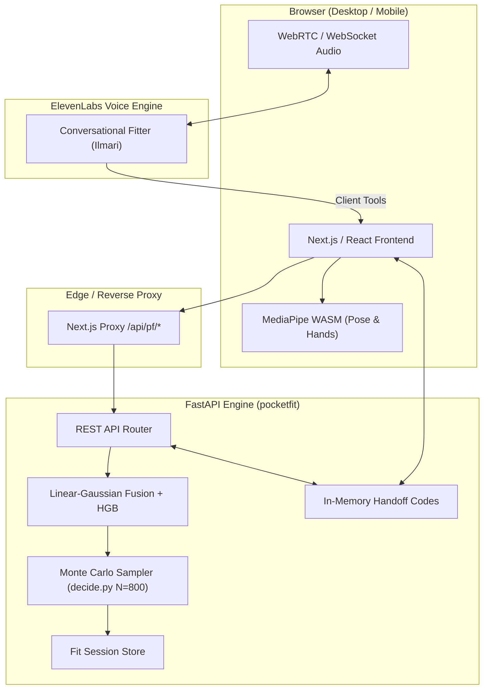
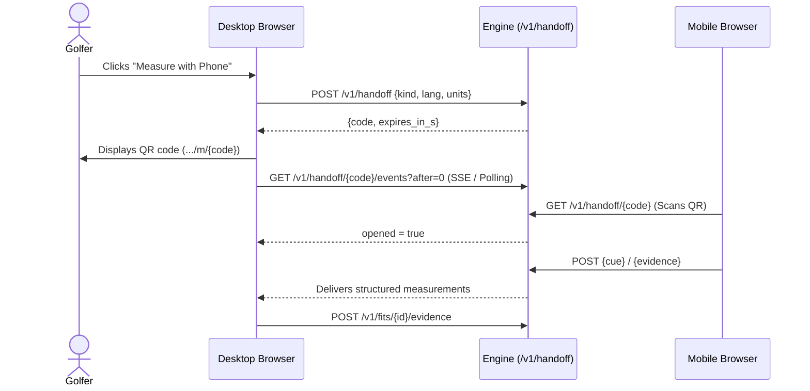

  <strong>The AI Pro-Fitter in Your Pocket</strong> 
  <em>Multimodal Voice Consultation · Zero-Print Smartphone Vision · Calibrated Bayesian Fitting</em>

  <a href="../README.md">« Home</a> ·
  <a href="README.md">Docs Index</a> ·
  <a href="https://takomo-fitter.web.app/">Live App</a> ·
  <a href="https://github.com/0xMuluh/takomo-fit">GitHub</a>

---

# Architecture & System Specification

**App:** Takomo Pocket Fitter · Next.js Frontend + FastAPI Fitting Engine (`pocketfit`)

---

## 1. System Topology

Core application routes:
* `/fit`: Multimodal conversational voice fitter (Ilmari).
* `/fit/guided`: Zero-voice, high-speed guided measurement funnel.
* `/m/[code]`: Zero-install mobile vision capture paired via QR code.

---

## 2. Zero-Egress Client-Side Computer Vision

Pose tracking, hand span measurement, ISO/IEC 7810 ID-1 card bounding, swing tempo extraction, and 4-point ball-line geometry run entirely on-device within the browser via WebAssembly (WASM).

Raw camera frames and video streams are strictly retained in volatile local memory. The FastAPI fitting engine receives only structured numerical evidence models (`BodyPhoto`, `HandPhoto`, `SwingVideo`, `ball_line_tilts_deg`), ensuring strict compliance with GDPR and biometric privacy standards.

Launch-monitor **screen photo / video import** is an isolated server route (`/v1/launch-monitor/*`) that extracts digital flight and launch metrics using OCR/vision parsing when configured.

---

## 3. Conversational Voice Architecture

1. Browser requests an authenticated session via **`GET /v1/voice/session`** (with optional `fit_id`).
2. The engine fetches an ephemeral signed WebSocket URL from ElevenLabs; all API keys remain server-side.
3. Rate limiting is enforced via `PF_VOICE_SESSIONS_PER_HOUR` (default: 20 sessions / IP / hr).
4. Ilmari invokes client-side tools to trigger camera workflows, update UI widgets, and query engine endpoints (`/v1/agent/*`) protected by `X-Agent-Secret`.

---

## 4. Desktop-to-Mobile Handoff Protocol

Handoff sessions are managed with a strict Time-to-Live (TTL); expired sessions return `404 Not Found`.

---

## 5. Fitting Pipeline Lifecycle

1. **Questionnaire Intake:** `POST /v1/fits` (`FitRequest`).
2. **Progressive Evidence Fusion:** `POST /v1/fits/{id}/evidence`.
3. **Posterior Sampling & Rules:** `FitResponse` returns specs, confidence distributions, reasons, stock vs. custom advice, and expected value of information (EVOI) next-test suggestions.
4. **Interactive What-If Playground:** `POST /v1/fits/{id}/what-if` (`Overrides`).

---

## 6. Operational Security & Controls

| Security Control | Implementation Mechanism |
|---|---|
| **Voice Session Security** | Ephemeral HMAC signed URLs; API credentials never exposed to client |
| **DDoS & Abuse Prevention** | Per-IP hourly sliding-window rate limiters on voice, handoff, and OCR |
| **Data Integrity** | Strict Pydantic boundary validation across all schema inputs |
| **Zero Biometric Retention** | On-device MediaPipe inference; zero video or facial image egress |
| **State Persistence** | Transient in-memory or file-backed storage decoupled from cloud state |

---

  Takomo Pocket Fitter · Built for the <strong>Since AI Hackathon 2026</strong> in partnership with <strong>Takomo Golf</strong>

