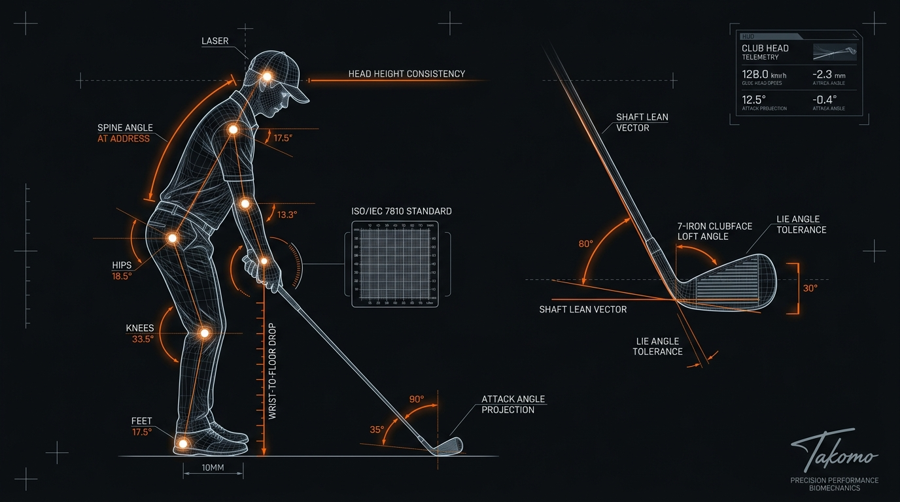

   &nbsp;•&nbsp; <strong>The Fitter in Your Pocket</strong>

  <a href="../README.md">Home</a> ·
  <a href="README.md">Docs</a> ·
  <a href="https://takomo-fitter.web.app/">Live App</a> ·
  <a href="https://github.com/0xMuluh/takomo-fit">GitHub</a>

---

# Computer vision & biomechanics pipeline

**Code modules:** `pocket-fitter/web/src/lib/vision/` · Capture UI: `web/src/components/capture/`  
**Execution runtime:** On-device WebAssembly (MediaPipe WASM + WebGL)

All computer vision routines—including full-body pose estimation, hand landmark tracking, card edge extraction, swing tempo detection, and 4-point impact geometry—execute strictly on the client device. Volatile camera frames never leave the browser.

---

## Biomechanics & measurement HUD

  
  
<em>Real-time on-device landmark tracking, card-calibrated hand scaling, and 4-point impact geometry</em>

---

## 1. Zero-print hand calibration via ISO/IEC 7810 ID-1

Conventional online fitters either demand printable calibration sheets or rely entirely on inaccurate self-reported glove sizes. Pocket Fitter utilizes any standard credit, debit, or ID card (ISO/IEC 7810 ID-1 standard: $85.60\text{ mm} \times 53.98\text{ mm}$) directly in the browser (`card.ts`):

$$s = \frac{85.60\,\mathrm{mm}}{w_{\mathrm{card,px}}}$$

The camera interface renders a precision guide box. `fitCard` performs edge snap verification and validates aspect ratios to discard severe perspective skew before passing scale factors to hand tracking.

---

## 2. Hand span landmark extraction & grip sizing

`hand.ts` utilizes MediaPipe Hands landmarks to measure the precise linear Euclidean distance from the distal wrist crease to the tip of the third (middle) digit.

Hand length is mapped directly to Takomo manufacturing glove bins and factory grip installations:

| Hand length ($\text{cm}$) | Takomo glove size | Installed grip size |
|---|---|---|
| $< 16.80$ | XS | Standard |
| $16.80 \le L < 17.80$ | S | Standard |
| $17.80 \le L < 18.59$ | M | Standard |
| $18.59 \le L < 19.40$ | M/L | Midsize |
| $19.40 \le L < 20.22$ | L | Midsize |
| $\ge 20.22$ | XL | Oversize |

* **Engine evidence contract:** `Evidence.hand_photo` $\to$ `HandPhoto { method, hand_length_cm, finger_length_cm? }`.

---

## 3. Pose analysis: stature & wrist-to-floor ratio

`body.ts` extracts biomechanic proportions via MediaPipe Pose:
* `method="ratio"`: Computes wrist-to-floor as an empirical proportion of total height, anchoring to stated stature.
* `method="reference"`: Uses reference objects to derive absolute stature and wrist-to-floor dimensions simultaneously.

Stance alignment is evaluated for posture quality (`good` vs `poor`), and real-time audio/visual cues guide golfer positioning during cross-device mobile handoff sessions.

---

## 4. Optical swing tempo extraction

`SwingVideo` analyzes continuous lead-wrist trajectories from high-frame-rate mobile video:
* Automatically identifies takeaway, top of backswing (zero velocity transition), and impact.
* Extracts `backswing_s` and `downswing_s` duration.
* Determines the kinetic tempo ratio ($3:1$ classic vs $2:1$ quick), fusing optical measurements with questionnaire self-reports.

---

## 5. Ball-line impact geometry (manual 4-point tap)

To avoid brittle edge-detection artifacts on dirty clubfaces, Pocket Fitter uses a guided 4-point impact registration protocol (`BallLineCapture.tsx`):
1. Golfer marks an equatorial line on a golf ball and strikes a minimum of 3 shots.
2. Golfer snaps a macro photo of the iron face.
3. Golfer taps 4 registration points: line bottom, line top, heel marker, toe marker.
4. `tiltDeg` in `ballLine.ts` calculates precise relative delivery angle (toe-up positive).

Direct delivery evidence lifts component lie accuracy to **58.3%** on the development benchmark (vs ~41% for questionnaire baselines).

---

  Takomo Pocket Fitter · Built with ❤️ for the <strong>Since AI Hackathon 2026</strong> in partnership with <strong>Takomo Golf</strong>

